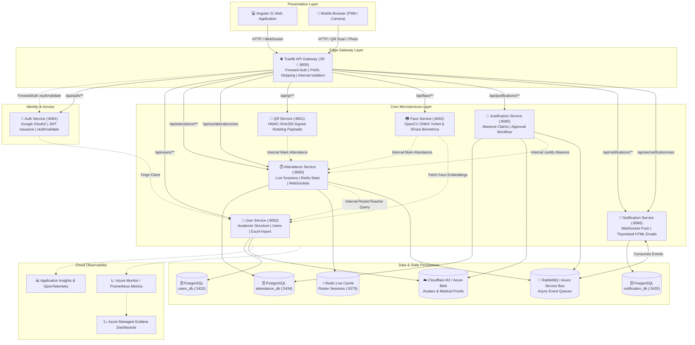

# 🎓 Attendance Platform

[](.github/workflows)
[](https://argo-cd.readthedocs.io/)
[](https://openjdk.org/)
[](https://spring.io/projects/spring-boot)
[](https://angular.dev/)
[](https://fastapi.tiangolo.com/)
[](https://traefik.io/)
[](https://sonarcloud.io/)
[](https://learn.microsoft.com/azure/azure-monitor/)

> **An enterprise-grade, cloud-native academic attendance and absence management ecosystem.** Built on a polyglot microservice architecture, featuring **multi-modal anti-fraud verification** (dynamic rotating QR codes, deep-learning facial biometrics, and GPS geofencing), real-time STOMP synchronization, end-to-end absence justification workflows, and automated **GitOps continuous delivery on Kubernetes**.

---

## 📌 Table of Contents

- [Overview](#-overview)
- [Key Features](#-key-features)
  - [Anti-Fraud Multi-Modal Attendance](#-anti-fraud-multi-modal-attendance)
  - [Absence Justification Pipeline](#-absence-justification-pipeline)
  - [Real-Time Notifications & Messaging](#-real-time-notifications--messaging)
  - [Academic Structure & Roster Management](#-academic-structure--roster-management)
- [System Architecture](#-system-architecture)
  - [Architecture Diagram](#architecture-diagram)
  - [Microservices Catalog](#microservices-catalog)
- [Zero-Trust Security & Gateway Routing](#-zero-trust-security--gateway-routing)
- [DevOps, CI/CD & GitOps Pipeline](#-devops-cicd--gitops-pipeline)
  - [GitHub Actions Workflows](#github-actions-workflows)
  - [GitOps with Argo CD & AKS](#gitops-with-argo-cd--aks)
  - [Alternative Jenkins Pipeline](#alternative-jenkins-pipeline)
- [Cloud Observability & Tracing](#-cloud-observability--tracing)
- [Repository Structure](#-repository-structure)
- [Local Development & Getting Started](#-local-development--getting-started)
  - [Prerequisites](#prerequisites)
  - [1. Infrastructure & Gateway](#1-start-infrastructure--gateway)
  - [2. Backend Services](#2-run-backend-services)
  - [3. Frontend Application](#3-run-frontend-application)
  - [Production Compose Stack](#production-compose-stack)
- [Documentation Index](#-documentation-index)

---

## 💡 Overview

Managing attendance in modern universities and higher education institutions presents persistent operational challenges: proxy attendance ("buddy punching"), inefficient paper sign-in rosters, cumbersome medical absence validation, and disconnected communication between faculty and administration.

**Attendance Platform** addresses these challenges with a production-ready, highly available distributed platform:

- **Strict Identity & Verification**: Ensures student physical presence through dynamic cryptographically signed QR codes (30-second rotating TTL), AI facial recognition (YuNet detection + SFace embedding matching), and GPS geofence checks.
- **Real-Time Responsiveness**: Uses Redis in-memory session states and WebSocket (STOMP) broadcasting to give instructors instant live headcounts and status updates.
- **Auditable Justification Life Cycle**: A dedicated workflow enabling students to upload supporting medical/administrative documentation to cloud object storage (Cloudflare R2 / Azure Blob) with multi-level teacher and administrative approvals that automatically update attendance records.
- **Enterprise-Grade DevOps**: Fully automated CI/CD with GitOps orchestration via Argo CD, container vulnerability gating via Aqua Trivy, code quality analysis via SonarCloud, and cloud observability with OpenTelemetry and Azure Monitor.

---

## ✨ Key Features

### 🛡️ Anti-Fraud Multi-Modal Attendance

The platform offers multiple flexible verification modes tailored for different classroom settings while eliminating proxy attendance:

1. **Dynamic Rotating QR Codes**:
   - Instructors project an animated QR code that automatically rotates every **30 seconds**.
   - Stateless HMAC-SHA256 signed payloads (`AQR1` format) encoding session ID, timestamps, and nonce.
   - Replay-attack resistant: expired or captured tokens cannot be reused or forwarded across group chats.
2. **Biometric Facial Recognition**:
   - Deep-learning facial pipeline powered by OpenCV and two pre-trained ONNX models:
     - **YuNet**: Ultra-fast face detection and alignment.
     - **SFace**: 128-dimensional facial embedding extraction.
   - Enrolls student biometric profiles and verifies live camera captures against stored embeddings using cosine similarity.
3. **Geofencing & Coordinate Validation**:
   - Instructors configure classroom GPS coordinates and tolerance radius (e.g. 100 meters).
   - Student mobile scans capture real-time device coordinates validated via the **Haversine formula**.
4. **Device Fingerprinting**:
   - Device uniqueness constraints prevent a single phone from scanning for multiple enrolled peers.
5. **Teacher Manual Override & Real-Time Sync**:
   - Teachers retain full manual control: mark present, late, excused, or absent directly on the live interactive roster.
   - Instant STOMP over WebSocket broadcasts push updates to teacher dashboards and student clients simultaneously.
6. **Automated Session Finalization**:
   - Scheduled background finalizers automatically close expired sessions, mark unrecorded students as `ABSENT`, compute aggregated session statistics, and write immutable records to PostgreSQL.

---

### 📑 Absence Justification Pipeline

Absence justifications are treated as a first-class asynchronous business workflow:

- **Student Submission**: Students view their marked absences and submit justifications with category metadata, personal statements, and file attachments (medical certificates, administrative notes).
- **Direct Cloud Object Storage**: File uploads are streamed directly to Cloudflare R2 / Azure Blob Storage via secure **presigned URLs**, keeping large binaries off backend application threads.
- **Role-Scoped Decision Workflow**:
  - **Teachers** review, comment on, approve, or reject justifications submitted for sessions they personally instructed.
  - **Administrators** possess institution-wide visibility and can audit or arbitrate all decisions.
- **Atomic Record Reconciliation**: Approving a justification atomically changes the attendance record from `ABSENT` to `JUSTIFIED` via inter-service Feign calls and triggers instant metric recalculation.

---

### 🔔 Real-Time Notifications & Messaging

A decoupled notification architecture ensures critical academic events reach users instantly:

- **Dual-Channel Delivery**:
  - **In-App Alerts**: Delivered via real-time WebSocket connections and persisted in database mailboxes with read/unread tracking.
  - **Transactional Emails**: Automated rich HTML emails generated via **Thymeleaf templates** (session started, absence alerts, justification decisions).
- **Event-Driven Messaging**:
  - Asynchronous event publishers and consumers with dual backend support:
    - **RabbitMQ** for lightweight local development.
    - **Azure Service Bus** topics and queues for cloud production.

---

### 🎓 Academic Structure & Roster Management

A comprehensive domain model designed for educational hierarchies:

- **Multi-Level Academic Topology**:
  - Academic Year (`AnneeUniversitaire`) &rarr; Cycle (`Cycle`) &rarr; Field (`Filiere`) &rarr; Formation (`Formation`) &rarr; Group (`Groupe`) &rarr; Module (`Module`).
- **Student Enrollment & Inscription**: Assigns students to active academic years and specific course sections.
- **High-Performance Excel Ingestion**:
  - Built-in Apache POI import engines for bulk onboarding of students, teachers, and course assignments.
  - Cell-level schema validation, conflict handling, and downloadable error diagnostics.
- **Profile Management**: Profile picture uploads via presigned URLs with Cloudflare R2 object storage.

---

## 🏗️ System Architecture

### Architecture Diagram

The system operates under a **microservice architecture** fronted by **Traefik API Gateway** with a centralized **ForwardAuth** security barrier:



---

### Microservices Catalog

| Service | Technology | Local Port | Container Port | Primary Storage | Key Responsibilities |
| :--- | :--- | :---: | :---: | :--- | :--- |
| **`frontend`** | Angular 21, Tailwind CSS v4, SSR Express | `4200` | `4000` | Browser Storage | Admin, teacher, and student responsive portals; dynamic QR display and camera scanner; OnPush signals. |
| **`auth-service`** | Spring Boot 3, Java 21, Spring Security | `8081` | `8080` | Stateless | Google ID token verification, platform JWT issuance, `/auth/validate` gateway validation endpoint. |
| **`user-service`** | Spring Boot 3, Java 21, Spring Data JPA | `8082` | `8080` | PostgreSQL (`users_db` : `5433`) | Academic hierarchy, user identities, student/teacher enrollment, bulk Excel parsing, Cloudflare R2 avatars, face embedding repository. |
| **`attendance-service`** | Spring Boot 3, Java 21, Redis, WebSockets | `8083` | `8080` | PostgreSQL (`attendance_db` : `5434`) + Redis (`6379`) | Attendance session lifecycle, ultra-fast Redis live roster states, STOMP broadcasts, geofencing, auto-finalizer scheduler. |
| **`qr-service`** | FastAPI, Python 3.11+, Pydantic | `8001` | `8000` | Stateless | Cryptographic rotating QR payload generator (HMAC-SHA256, 30s TTL, `AQR1` format), scan validation, attendance marking forwarder. |
| **`face-service`** | FastAPI, Python 3.11+, OpenCV, ONNX Runtime | `8002` | `8000` | Stateless (Models) | Facial detection (YuNet) and recognition (SFace), 128-d embedding extraction, face enrollment, biometric attendance marking. |
| **`justification-service`** | Spring Boot 3, Java 21, Spring Data JPA | `8085` | `8080` | PostgreSQL | Absence justification submissions, Cloudflare R2 / Azure Blob presigned upload generation, teacher/admin reviews, Feign attendance reconciler. |
| **`notification-service`** | Spring Boot 3, Java 21, Spring Data JPA | `8086` | `8080` | PostgreSQL (`notification_db` : `5435`) | Multi-channel notifications, STOMP in-app messaging, Thymeleaf transactional HTML emails, RabbitMQ & Azure Service Bus consumers. |
| **`traefik`** | Traefik v3 | `80`, `9000` | `80`, `8080` | File / Docker Provider | API Gateway routing, prefix stripping, ForwardAuth middleware, isolation of internal routes. |

---

## 🔒 Zero-Trust Security & Gateway Routing

Security is enforced at the edge rather than duplicated across microservices:

```text
Browser Client
   │ (Bearer JWT)
   ▼
Traefik API Gateway (:80)
   ├─── 1. ForwardAuth Check ──────► Auth Service: GET /auth/validate
   │                                  │ Checks JWT signature, expiration, revocation
   │                                  ▼
   │◄── 2. Injects Trusted Headers ── Returns 200 OK
   │       X-User-Id, X-User-Roles, X-User-Email
   ▼
Protected Downstream Service (:8080)
   └── Validates @RequireRole("TEACHER" / "ADMIN") against injected headers
```

### Gateway Route Configuration

| Public Gateway Route | Upstream Service | Stripped Prefix | Middleware Chain | Access Control |
| :--- | :--- | :--- | :--- | :--- |
| `/api/auth/**` | `auth-service` | `/api` | `strip-api-auth` | Public (Login & token exchange) |
| `/api/users/**` | `user-service` | `/api` | `forward-auth`, `strip-api-user` | Protected (Roles enforced) |
| `/api/attendance/**` | `attendance-service` | `/api` | `forward-auth`, `strip-api-attendance` | Protected (Roles enforced) |
| `/api/ws/attendance/ws` | `attendance-service` | `/api/ws` | `strip-api-ws-attendance` | Authenticated via STOMP `CONNECT` |
| `/api/qr/**` | `qr-service` | `/api` | `forward-auth`, `strip-api-qr` | Protected (Teacher / Student) |
| `/api/face/**` | `face-service` | `/api` | `forward-auth`, `strip-api-face` | Protected (Student / Teacher) |
| `/api/justifications/**` | `justification-service` | `/api` | `forward-auth`, `strip-api-justification` | Protected (Role-scoped access) |
| `/api/notifications/**` | `notification-service` | `/api` | `forward-auth`, `strip-api-notification` | Protected (User mailbox) |
| `/api/ws/notifications/ws` | `notification-service` | `/api/ws` | `strip-api-ws-notifications` | Authenticated via STOMP `CONNECT` |
| `/**` | `frontend` | *None* | *None* | Public Angular UI shell |

### Internal Route Isolation

To enforce least-privilege security, all internal inter-service endpoints are explicitly shielded at the gateway level:

```yaml
# Example from traefik/routes.dev.yml:
rule: "PathPrefix(`/api/users`) && !PathPrefix(`/api/users/internal`)"
rule: "PathPrefix(`/api/attendance`) && !PathPrefix(`/api/attendance/internal`)"
rule: "PathPrefix(`/api/notifications`) && !PathPrefix(`/api/notifications/internal`)"
```

Attempts to invoke `/api/*/internal/**` from external clients are rejected immediately. Inter-service calls require direct machine-to-machine routing accompanied by the trusted header:
```http
X-Request-Source: <calling-service-name>
Authorization: Bearer <internal-service-token>
```

---

## 🚀 DevOps, CI/CD & GitOps Pipeline

The repository utilizes an enterprise CI/CD and GitOps delivery pipeline:

```text
[ Developer PR ] ──► [ pr-ci.yml: Multi-Service Matrix Build + JaCoCo + SonarCloud Scan ]
                           │
                           ▼ (Merge to main)
[ Push to main ] ──► [ release.yml: Semver Tagging + Multi-Image GHCR Build ]
                           │
                           ├──► [ Aqua Trivy Container Vulnerability Scan ]
                           │
                           ├──► [ GitOps Commit & PR against Ay0u8dev/attendance-infra ]
                           │          │
                           │          ▼
                           │    [ Argo CD Pulls & Reconciles onto Azure AKS ]
                           │
                           └──► [ Slack Release Notification ]
```

### GitHub Actions Workflows

1. **Pull Request CI (`.github/workflows/pr-ci.yml`)**:
   - Triggered on any pull request targeting `main`.
   - **Parallel Java Matrix**: Compiles, unit tests, and measures JaCoCo code coverage across 5 Spring Boot services (`auth`, `user`, `attendance`, `justification`, `notification`).
   - **SonarCloud Static Analysis**: Analyzes code quality, test coverage, and vulnerabilities across **8 dedicated SonarCloud projects**.
   - **Frontend CI**: Executes Vitest unit tests, lints, and verifies the Angular production SSR build.
   - **Python CI**: Runs Pytest suites and test coverage for `qr-service` and `face-service`.

2. **Main Release & GitOps Handoff (`.github/workflows/release.yml`)**:
   - Executes upon merge to `main`.
   - Generates an immutable release tag (`0.0.N` + `sha-<commit>`).
   - Builds production multi-stage Docker images and pushes to **GitHub Container Registry (GHCR)**.
   - Executes **Aqua Trivy** container vulnerability scans for high/critical CVEs, uploading SARIF reports to GitHub Security.
   - **GitOps Handoff**: Automatically checks out the infrastructure repository (`Ay0u8dev/attendance-infra`), updates container image tags in Kubernetes manifests, verifies AKS configurations, and opens a pull request.
   - **Argo CD** synchronizes the new image tags into **Azure Kubernetes Service (AKS)**.
   - Sends a comprehensive deployment status report to **Slack**.

### Alternative Jenkins Pipeline

For self-hosted or private runner setups, a complete declarative [`Jenkinsfile`](./Jenkinsfile) is provided:
- Checkout & multi-service Maven test execution (`mvnw test`).
- Production Docker Compose container builds.
- Automated **Aqua Trivy** security scans with Slack alerting on critical vulnerabilities.
- Production compose zero-downtime rolling restart.

---

## 📊 Cloud Observability & Tracing

The platform is instrumented for centralized monitoring without requiring in-cluster Prometheus/Grafana stateful overhead:

- **Distributed Request Tracing**: End-to-end distributed tracing across Java and Python microservices using **OpenTelemetry** integrated with **Azure Monitor Application Insights**.
- **Prometheus Metric Exposition**:
  - Spring Boot services expose `/actuator/prometheus` (HTTP percentiles, JVM heap/non-heap memory, database connection pool stats).
  - FastAPI services expose `/metrics` via Prometheus FastAPI Instrumentator (`qr_payloads_created_total`, `qr_scan_attempts_total`, biometric verification latencies).
  - Metrics are scraped automatically by **Azure Monitor Managed Prometheus** through Kubernetes pod annotations.
- **Dashboards & Visualizations**: Pre-configured **Azure Managed Grafana** dashboards for cluster capacity, container memory/CPU, and API latency percentiles (p95, p99).
- **Log Aggregation**: Container stdout/stderr logs and cluster events centralized via **Azure Log Analytics** and **Container Insights**.

---

## 📁 Repository Structure

```text
attendance_platform/
├── .github/
│   └── workflows/                # Production CI/CD pipelines (PR validation, GitOps release)
├── backend/
│   ├── auth-service/             # Google OAuth2 verification & platform JWT issuer
│   ├── user-service/             # Users, roles, academic structure, Excel import, avatars
│   ├── attendance-service/       # Live attendance sessions, Redis state, WebSockets, finalizer
│   ├── qr-service/               # HMAC-SHA256 rotating QR payload generator & scanner
│   ├── face-service/             # OpenCV ONNX YuNet & SFace facial biometrics engine
│   ├── justification-service/    # Absence justification workflow & document uploads
│   ├── notification-service/     # Multi-channel notifications (WebSockets & Thymeleaf emails)
│   └── docs/                     # Comprehensive API contracts, architecture guides, and flows
├── frontend/                     # Angular 21 Standalone SPA, Tailwind CSS v4, SSR
│   ├── src/app/core/             # Shared domain services, interceptors, guards
│   ├── src/app/features/         # Admin, Teacher, Student, and Attendance modules
│   └── src/app/shared/           # Design system UI components (tables, modals, badges)
├── traefik/                      # API Gateway reverse proxy configurations (dev & prod)
├── devops-learning-notes/        # Technical notes covering K3s, GitOps, AKS, and registries
├── k8s-learning/                 # Kubernetes manifests (deployments, stateful sets, ingress)
├── docker-compose.yml            # Local development orchestration (infrastructure & Traefik)
├── docker-compose.prod.yml       # Production-like multi-container orchestration
├── Jenkinsfile                   # Declarative CI/CD pipeline with Trivy & Slack notifications
├── .env.example                  # Environment configuration template
└── README.md                     # Repository presentation and guide
```

---

## 🛠️ Local Development & Getting Started

### Prerequisites

Ensure you have the following installed on your host machine:

- **Java**: OpenJDK `21`
- **Node.js**: `20.x` or `22.x` and `npm`
- **Python**: `3.11+`
- **Docker**: Docker Engine & Docker Compose v2
- **Git**

---

### 1. Start Infrastructure & Gateway

From the repository root, start the supporting databases, Redis, messaging, and Traefik:

```powershell
# Copy environment configuration
Copy-Item .env.example .env

# Spin up databases, cache, broker, and gateway
docker compose up -d traefik redis user-db attendance-db notification-db rabbitmq
```

Verify that containers are healthy:
- Traefik API Gateway: [http://localhost](http://localhost)
- Traefik Dashboard: [http://localhost:9000](http://localhost:9000)
- RabbitMQ Management: [http://localhost:15672](http://localhost:15672) (User: `guest` / Pass: `guest`)

---

### 2. Run Backend Services

Run each backend service from its respective directory using separate terminal windows:

#### Spring Boot Services (Java 21)

```powershell
# 1. Auth Service (:8081)
cd backend/auth-service
./mvnw spring-boot:run

# 2. User Service (:8082)
cd backend/user-service
./mvnw spring-boot:run

# 3. Attendance Service (:8083)
cd backend/attendance-service
./mvnw spring-boot:run

# 4. Justification Service (:8085)
cd backend/justification-service
./mvnw spring-boot:run

# 5. Notification Service (:8086)
cd backend/notification-service
./mvnw spring-boot:run
```

#### FastAPI Services (Python 3.11+)

```powershell
# QR Service (:8001)
cd backend/qr-service
python -m venv .venv
.\.venv\Scripts\Activate.ps1
pip install -r requirements.txt
$env:ATTENDANCE_SERVICE_URL="http://localhost:8083"
$env:QR_TOKEN_SECRET="dev-only-change-me"
uvicorn main:app --host 0.0.0.0 --port 8001 --reload

# Face Service (:8002)
cd backend/face-service
python -m venv .venv
.\.venv\Scripts\Activate.ps1
pip install -r requirements.txt
uvicorn app.main:app --host 0.0.0.0 --port 8002 --reload
```

---

### 3. Run Frontend Application

Launch the Angular 21 development server:

```powershell
cd frontend
npm install
npm start
```

Access the application through the Traefik Gateway at:
👉 **[http://localhost](http://localhost)** (or standalone dev server at [http://localhost:4200](http://localhost:4200))

---

### Production Compose Stack

To run the entire platform as fully containerized services using production multi-stage images:

```powershell
# Configure production secrets
Copy-Item .env.prod.example .env.prod

# Build and start all services
docker compose -f docker-compose.prod.yml up --build -d
```

---

## 📚 Documentation Index

Detailed architectural decisions, endpoint contracts, and operational guidelines are maintained in the repository:

| Guide / Document | Location | Description |
| :--- | :--- | :--- |
| **Backend Architecture** | [`backend/docs/backend-architecture.md`](./backend/docs/backend-architecture.md) | In-depth topology, service boundaries, and data ownership rules. |
| **Service Contracts** | [`backend/docs/backend-service-contracts.md`](./backend/docs/backend-service-contracts.md) | Exhaustive HTTP, WebSocket, DTO, and header specifications. |
| **Student Attendance Flow** | [`backend/docs/student-attendance-flow.md`](./backend/docs/student-attendance-flow.md) | End-to-end lifecycle from session creation to auto-finalization. |
| **QR Code Security Flow** | [`backend/docs/qr-code-flow.md`](./backend/docs/qr-code-flow.md) | Rotating HMAC token structure, replay prevention, and validation rules. |
| **Justification Workflow** | [`backend/docs/justification-workflow.md`](./backend/docs/justification-workflow.md) | Canonical student submission, cloud storage, and review lifecycle. |
| **Cloud Observability** | [`backend/docs/observability.md`](./backend/docs/observability.md) | OpenTelemetry, Prometheus metrics, Grafana, and Azure Monitor setup. |
| **Excel Ingestion Rules** | [`backend/docs/admin/excel-import-rules.md`](./backend/docs/admin/excel-import-rules.md) | Schema validation, column rules, and error handling for bulk imports. |
| **Frontend Architecture** | [`frontend/PROJECT_STRUCTURE.md`](./frontend/PROJECT_STRUCTURE.md) | Angular 21 directory layout, standalone component architecture, and SSR. |
| **Frontend Design Language** | [`frontend/DESIGN_LANGUAGE.md`](./frontend/DESIGN_LANGUAGE.md) | Institutional administrative design guidelines, color tokens, and UI patterns. |
| **CI/CD & GitOps Guide** | [`.github/workflows/README.md`](./.github/workflows/README.md) | Pull request validation, SonarCloud setup, GHCR packaging, and GitOps handoff. |
| **DevOps Learning Notes** | [`devops-learning-notes/`](./devops-learning-notes/) | Step-by-step engineering journals from K3s homelab to Azure AKS GitOps. |

---

## 📄 License & Credits

Developed with modern clean code principles, zero-trust security architecture, and GitOps automation.  
Designed for universities, colleges, and higher education institutes requiring fraud-proof attendance management.
